<picture>
  <source media="(prefers-color-scheme: light)" srcset="assets/neutral-header.svg">
  
</picture>

Computer Science (Software Engineering) at Alamein International University. Open to internships, open-source collaboration, and systems engineering roles.

[LinkedIn](https://www.linkedin.com/in/mohamed-soliman-aa3b26287/)

<h2><picture>
  <source media="(prefers-color-scheme: light)" srcset="assets/neutral-banner-numbers.svg">
  
</picture></h2>

<picture>
  <source media="(prefers-color-scheme: light)" srcset="assets/neutral-stats.svg">
  
</picture>

<h2><picture>
  <source media="(prefers-color-scheme: light)" srcset="assets/neutral-banner-languages.svg">
  
</picture></h2>

<picture>
  <source media="(prefers-color-scheme: light)" srcset="assets/neutral-languages.svg">
  
</picture>

<h2><picture>
  <source media="(prefers-color-scheme: light)" srcset="assets/neutral-banner-contrib.svg">
  
</picture></h2>

<picture>
  <source media="(prefers-color-scheme: light)" srcset="assets/neutral-contrib.svg">
  
</picture>

<h2><picture>
  <source media="(prefers-color-scheme: light)" srcset="assets/neutral-banner-building.svg">
  
</picture></h2>

- **KETA**: kernel memory forensics research on Android ARM64
- **UniHub**: verified campus marketplace
- **Genesis**: distributed P2P framework

<h2><picture>
  <source media="(prefers-color-scheme: light)" srcset="assets/neutral-banner-projects.svg">
  
</picture></h2>

Open a language to see its repositories.

<b>C</b> (2)

- [**KETA**](https://github.com/xchan404/KETA): No description (1 stars, 0 forks)
- [**Basik-Forks**](https://github.com/xchan404/Basik-Forks): No description (0 stars, 0 forks)

<b>JavaScript</b> (2)

- [**xchan404**](https://github.com/xchan404/xchan404): No description (0 stars, 0 forks)
- [**Track-it**](https://github.com/xchan404/Track-it): No description (0 stars, 0 forks)

<b>Python</b> (2)

- [**Chat2Query**](https://github.com/xchan404/Chat2Query): No description (0 stars, 0 forks)
- [**Hospital-System-Mangment**](https://github.com/xchan404/Hospital-System-Mangment): No description (0 stars, 0 forks)

<b>Other</b> (1)

- [**Transport-Company**](https://github.com/xchan404/Transport-Company): My First Project As computer Sconce student  (0 stars, 0 forks)

Updated 2026-10-13 by a scheduled GitHub Action. Animations stop when your system asks for reduced motion.
